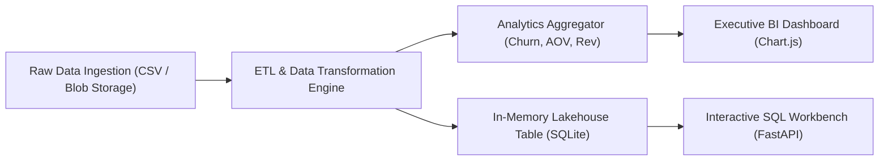

# 📊 Azure Data Analytics Pipeline & BI Lakehouse Workbench

[](https://www.python.org/)
[](https://fastapi.tiangolo.com)
[](https://azure.microsoft.com/)
[](https://sqlite.org)
[](https://opensource.org/licenses/MIT)

An enterprise-grade **Cloud Data Analytics & Lakehouse ETL Pipeline** simulating Azure Synapse Analytics and Databricks data processing. Ingests raw cloud transactional logs, runs aggregations, calculates customer churn probability, and serves an interactive executive Business Intelligence (BI) dashboard with an in-browser SQL workbench.

---

## 🌟 Key Highlights

- **Automated Ingestion & ETL**: Ingests multi-region cloud sales telemetry, standardizes schemas, and enriches data with customer churn risk markers.
- **In-Memory Analytical Lakehouse**: Embedded SQL query engine permitting ad-hoc analytical queries (`GROUP BY`, `ORDER BY`, multi-column aggregations) with built-in query safety guardrails.
- **Executive BI Dashboard**: High-impact visualizations using Chart.js, rendering regional revenue distributions, category sales breakdown, and customer retention metrics.
- **Interactive SQL Workbench**: Real-time SQL execution console with instant tabular previews and CSV dataset export.
- **Enterprise Ready**: Full automated test suite verifying data transformations and query sanitization.

---

## 🏗️ Architecture Pipeline



---

## 📁 Repository Structure

```text
azure-data-analytics-pipeline/
├── data/
│   └── sample_sales_data.csv       # Multi-region cloud transactional dataset
├── pipeline/
│   └── etl.py                     # ETL logic, summary aggregations & SQL query executor
├── templates/
│   └── index.html                 # Modern BI Dashboard & SQL Workbench UI
├── app.py                         # FastAPI web application & REST API endpoints
├── test_pipeline.py               # Unit & integration test suite
├── requirements.txt               # Dependencies
├── run.ps1                        # One-click test & execution runner
└── README.md                      # Comprehensive project documentation
```

---

## 🚀 Quickstart Guide

### 1. Clone the Repository
```bash
git clone https://github.com/shrey2021/azure-data-analytics-pipeline.git
cd azure-data-analytics-pipeline
```

### 2. Set Up Environment & Install Dependencies
```bash
python -m venv venv
# On Windows:
.\venv\Scripts\activate
# On Linux/macOS:
source venv/bin/activate

pip install -r requirements.txt
```

### 3. Run Automated Tests
```bash
python test_pipeline.py
```

### 4. Launch the BI Dashboard
```bash
python app.py
```
Open **[http://127.0.0.1:8001](http://127.0.0.1:8001)** in your browser.

---

## 📊 Sample SQL Queries to Test

Try executing these inside the in-app SQL Workbench:

#### 1. Top Performing Azure Regions by Revenue
```sql
SELECT region, COUNT(*) AS transactions, ROUND(SUM(total_revenue), 2) AS revenue 
FROM sales 
GROUP BY region 
ORDER BY revenue DESC;
```

#### 2. High-Risk Customer Churn Accounts
```sql
SELECT customer_id, region, product_category, total_revenue 
FROM sales 
WHERE is_churn_risk = 1 
ORDER BY total_revenue DESC;
```

#### 3. Average Unit Price & Total Units by Cloud Service
```sql
SELECT product_category, ROUND(AVG(unit_price), 2) AS avg_price, SUM(units) AS total_units 
FROM sales 
GROUP BY product_category 
ORDER BY total_units DESC;
```

---

## 🛡️ License
Distributed under the **MIT License**. See `LICENSE` for more information.
